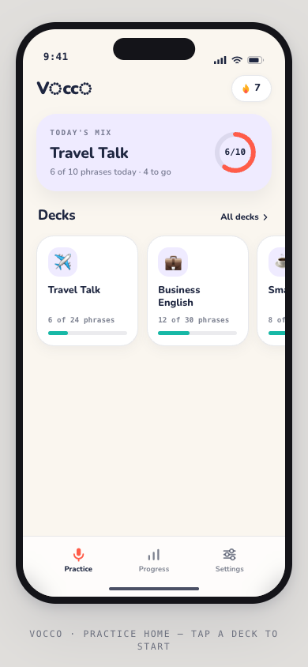
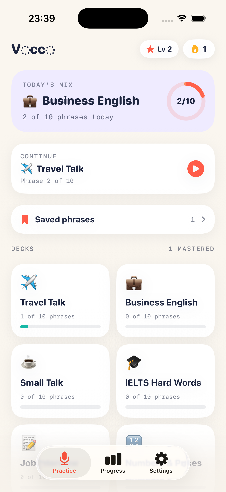

# Vocco 🎙️

**Pronunciation coach for English learners — hear it, say it, nail it.**

Vocco plays a phrase with a native voice, records your attempt, and scores it
word by word. Built on ElevenLabs TTS + Scribe STT, with all scoring done
**locally** — zero LLM tokens, near-zero running cost.


| Design (OpenDesign) | Built (SwiftUI) |
|---|---|
|  |  |

## How it works

1. **Hear it** — the phrase is spoken by an ElevenLabs voice (`eleven_flash_v2_5`),
   with a 🐢 slow / 🐇 normal toggle.
2. **Say it** — record your take (max 12 s, auto-stop).
3. **Score it** — [Scribe](https://elevenlabs.io/speech-recognition) transcribes your take,
   and a local Needleman–Wunsch word alignment colors every word:
   🟢 nailed / 🟡 off. Play *mine* vs *ideal* side by side, retry, next.

Progress compounds: daily streak 🔥, XP & levels ⭐ (+10 per attempt,
+15 per strong take ≥ 85, +25 per mastered phrase), an 8-week streak calendar,
accuracy trend, and a "words to work on" mastery list. Bookmark any phrase to
the Saved list and jump straight back into it.

## Features

- 🗂️ **8 decks · 80 phrases** — Travel, Business, Small Talk, IELTS hard words,
  Job Interview, Numbers & Prices, Doctor & Emergency, Tech & Remote Work
  (each with IPA, translations and a stress-tip)
- 🎧 4 coach voices (ElevenLabs premade library — no extra charges)
- 📈 Streaks, XP levels, weekly accuracy trend (Swift Charts), tricky-word mastery
- 🔖 Saved phrases with instant resume ("Continue" card)
- 🔐 API key stored in the iOS **Keychain** — never in UserDefaults or plain files
- 🔔 Optional daily 7 PM practice reminder

## Setup (BYOK — bring your own key)

1. Create a free API key at [elevenlabs.io](https://elevenlabs.io)
   (Profile → API Keys). Grant only: **Text to Speech** + **Speech to Text**.
2. Copy the example file and paste your key:

   ```bash
   cp Vocco/Secret.key.example Vocco/Secret.key
   ```

`Secret.key` is **git-ignored**. At build time it is bundled into the app and
moved into the Keychain on first launch — no key entry UI, nothing in git.

## Build

Requires Xcode 26+, [xcodegen](https://github.com/yonaskolb/XcodeGen), iOS 17+.

```bash
brew install xcodegen
xcodegen generate
xcodebuild -project Vocco.xcodeproj -scheme Vocco \
  -destination 'platform=iOS Simulator,name=iPhone 17 Pro' build
```

Or generate the project and open `Vocco.xcodeproj` in Xcode.
The first tap on the mic triggers the system microphone-permission dialog —
choose **Allow**.

## Project structure

```
VoccoApp/
├── project.yml                  # xcodegen spec → Vocco.xcodeproj
├── Vocco/
│   ├── VoccoApp.swift           # App entry + root tab view
│   ├── DesignSystem.swift       # Brand tokens, pills/cards, wordmark, flow layout
│   ├── Models.swift             # Deck/Phrase models + local scoring engine
│   ├── Store.swift              # @Observable state, persistence, streaks, XP/levels
│   ├── Audio.swift              # Recorder, player, ElevenLabs TTS + Scribe client
│   ├── Keychain.swift           # Keychain wrapper for the API key
│   ├── PracticeHomeView.swift   # Today's Mix, continue, saved entry, deck grid
│   ├── PhrasePracticeView.swift # The listen → record → score loop
│   ├── ProgressTabView.swift    # Streak calendar, stats, trend, tricky words
│   ├── SettingsView.swift       # Voice picker, daily goal, reminders
│   ├── SavedPhrasesView.swift   # Bookmarked phrases
│   ├── decks.json               # 8 decks · 80 phrases
│   └── Secret.key.example       # template for your key (Secret.key is ignored)
```

## Design system

Warm ivory `#FAF6EF` · ink indigo `#1E2640` · signature coral `#FF5C49`
(speaking actions only) · success teal `#17B8A6` · warning amber `#FFB020` ·
coach lilac `#EFEBFF`. Rounded geometric type (SF Pro Rounded), monospaced
IPA/timers, pill cards, waveform motifs — the dotted “o”s in the wordmark
included. Screens were designed with [OpenDesign](https://open-design.ai)
briefs and ported 1:1 to SwiftUI.

## Cost

- TTS (`eleven_flash_v2_5`): **0.5 credits/char** → a typical phrase ≈ 17 credits
- STT (`scribe_v1`): billed per second, pennies per hour
- Free tier (~10k credits/month) covers **hundreds of practice sessions**
- Scoring, streaks, levels: **local Swift, zero API calls**

## Security notes

- `Vocco/Secret.key` is git-ignored by default — it never reaches the repo.
- A key bundled in an `.ipa` **can be extracted** from the binary. Fine for
  personal builds and simulator testing; before any public distribution
  (TestFlight/App Store) put the key behind a tiny backend proxy
  (e.g. a Cloudflare Worker) so it never ships inside the app.
- Rotate your key at ElevenLabs immediately if it ever leaks.

## Roadmap

- [ ] App icon & launch screen polish
- [ ] Backend proxy option for public builds
- [ ] More decks & custom phrase lists
- [ ] Sound-level drills (th /θ/, r–w, minimal pairs)

---

Made with ❤️ and ElevenLabs. *Vocco — say it right.*
